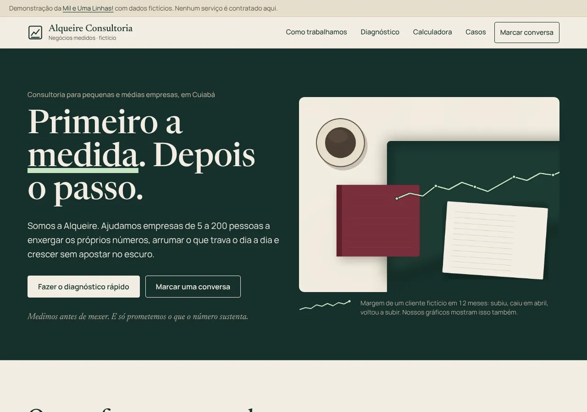
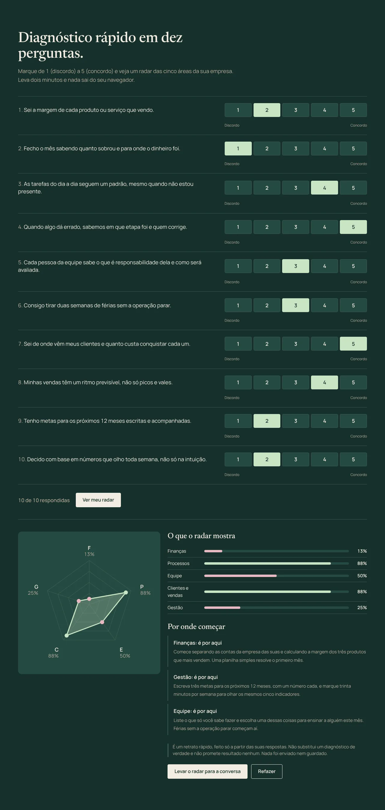
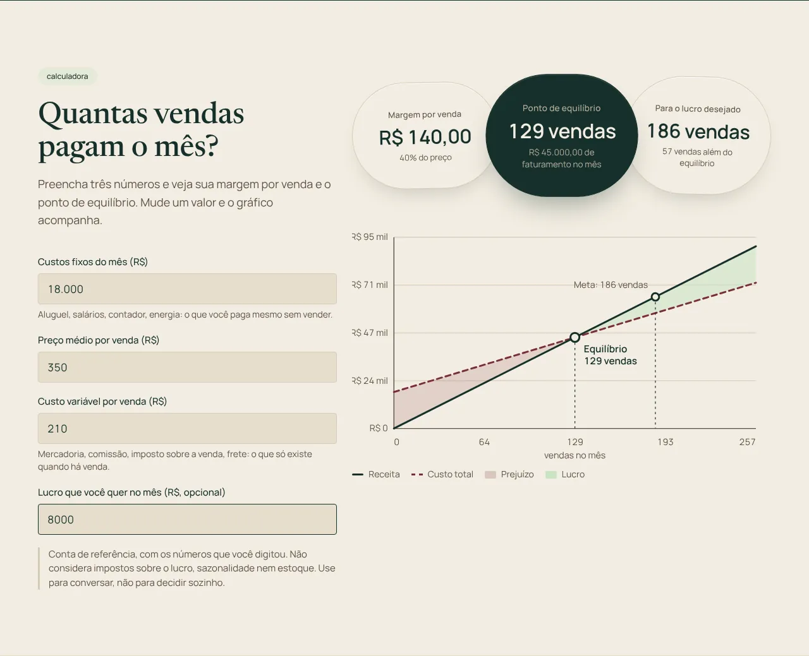
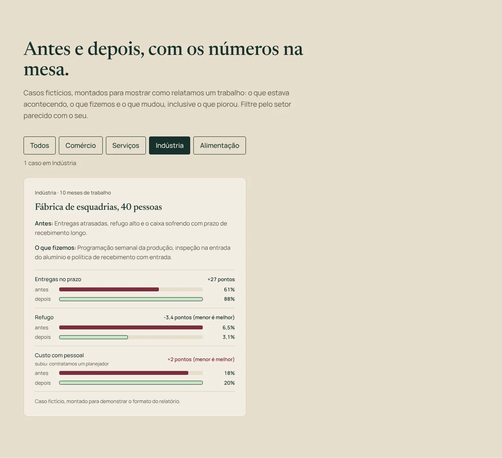
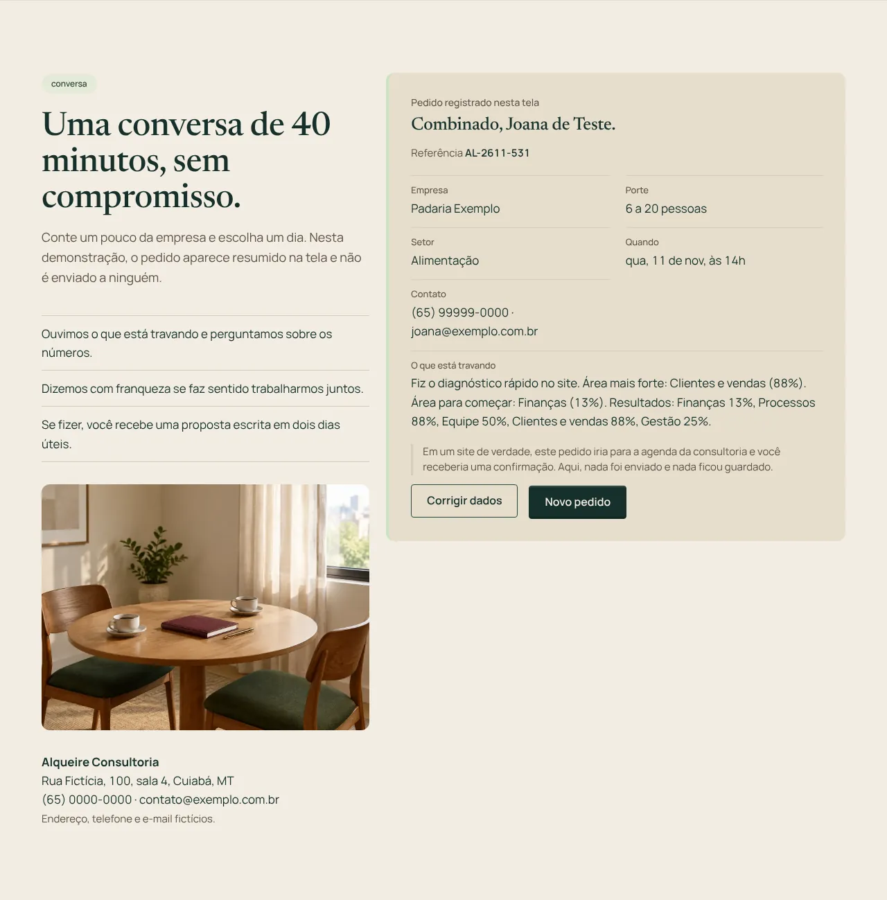

# Alqueire Consultoria: site de demonstração para consultorias de negócios

Eu, Rodrigo Jr, da [Mil e Uma Linhas!](https://mileumalinhas.com.br), fiz este site para mostrar a uma consultoria de pequenas e médias empresas como pode ser um site dela: com identidade própria, com números na mesa e com funções que o visitante usa de verdade, não só lê.

**Tudo aqui é fictício.** A Alqueire Consultoria não existe. As pessoas, o endereço, o telefone, o e-mail, os casos de cliente e os valores das calculadoras foram inventados para a demonstração. Nenhum serviço é contratado, nenhum dado é enviado e nada fica guardado.

Endereço quando publicado: `https://toshiro01001.github.io/consultoria/`

## O que o site é, para quem não é da área

É a página de uma consultoria que ajuda empresas de 5 a 200 pessoas a enxergar os próprios números, arrumar processos e crescer com conta feita. Nele você pode:

1. **Fazer um diagnóstico rápido.** Dez perguntas de 1 a 5. No fim aparece um radar com as cinco áreas da empresa (finanças, processos, equipe, clientes e vendas, gestão), com as áreas fracas e fortes e três sugestões genéricas de por onde começar. Sem promessa de resultado.
2. **Descobrir quantas vendas pagam o mês.** Digite os custos fixos, o preço médio e o custo por venda. O site mostra a margem por venda, o ponto de equilíbrio e um gráfico com a faixa de prejuízo e a faixa de lucro. Se o preço não cobre o custo, ele avisa que não existe ponto de equilíbrio.
3. **Ler casos de cliente antes e depois.** Seis casos fictícios, com filtro por setor, mostrando o que estava acontecendo, o que foi feito e o que mudou em cada indicador, inclusive um que piorou.
4. **Marcar uma conversa inicial.** Formulário com dia (os próximos dez dias úteis) e horário. O site confere os dados, aponta o que falta e mostra um resumo na tela, sem enviar nada.

## Como usar, em passos

1. Abra o site. A faixa do topo lembra que é uma demonstração.
2. Role até **Diagnóstico** e marque uma nota em cada pergunta. Clique em **Ver meu radar**. Se faltar alguma, o site mostra qual.
3. Clique em **Levar o radar para a conversa** para o resultado ir direto para o campo de mensagem do pedido de conversa.
4. Em **Calculadora**, mude os números. A margem, o ponto de equilíbrio e o gráfico mudam na hora. Deixe a meta de lucro em branco para ver só o equilíbrio.
5. Em **Casos**, clique em um setor para filtrar.
6. Em **Marcar conversa**, preencha os dados, escolha dia e horário e clique em **Pedir a conversa**. O resumo aparece com uma referência. **Corrigir dados** volta ao formulário com tudo preenchido; **Novo pedido** limpa.

## Capturas

| Computador | Celular |
|---|---|
|  |  |

| Diagnóstico com radar | Calculadora de ponto de equilíbrio |
|---|---|
|  |  |

| Casos antes e depois | Pedido de conversa e resumo |
|---|---|
|  |  |

As capturas do celular de cada função estão em `docs/` com o sufixo `-celular`.

## Identidade visual, em resumo

O estudo completo está em [`docs/identidade.md`](docs/identidade.md).

- **Nome e frase:** Alqueire Consultoria, "Primeiro a medida. Depois o passo." O alqueire é a medida de terra que todo mundo em Mato Grosso conhece; a marca mede antes de mexer.
- **Paleta:** papel quente `#F3EDE2` e papel escuro `#E6DDCC` de fundo; verde-mata `#16302B` no texto, no cabeçalho e nas seções escuras; terra `#5C5247` nos textos de apoio; menta `#C9E4C5` como único destaque claro, uma vez por tela; vinho `#7A2E3B` como contraponto honesto (o "antes", a área fraca, o prejuízo, os erros). Sem azul-corporativo, sem gradiente.
- **Superfície (leva final):** padrões de dois design systems do catálogo da Mil e Uma Linhas!, em código próprio: o terrasprint-ai nas seções claras (cápsula de navegação fosca flutuante, cartões de papel com sombra tingida, eyebrows em pílula, três pílulas-estádio na calculadora, cartões de caso com painel interno, botões com seta que anda, rise reveal e um bloom verde que segue o ponteiro no hero) e o ix7-mission nas escuras (painéis de vidro no diagnóstico, faixa de status no hero, cartões de token no resultado, controle de segmentos nas respostas e painéis de ação com borda a 27% no diagnóstico e no rodapé). A tabela completa está em `docs/identidade.md`.
- **Fontes:** Newsreader (serifada de jornal, variável, contraste alto nos títulos) e Manrope (sans geométrica com algarismos tabulares para todos os números). As duas são locais, em `fonts/`, com licença SIL OFL ao lado.
- **Por quê:** a mesa de quem fecha o mês: papel, a capa verde do livro-caixa, a lombada vinho do caderno e um traço de marca-texto. Os gráficos são o elemento gráfico da marca e são honestos: a linha do hero sobe, cai e volta a subir; o radar mostra o fraco junto do forte; a calculadora mostra a faixa de prejuízo.
- **Fotos:** todas as fotos do site são geradas por IA no Canva e são ilustrativas: a do hero (4:3, 1440x1080) e as oito da leva final, listadas abaixo. Os arquivos da leva final em `img/` são as fotos finais do Canva, convertidas para webp no nome e na proporção certos.

| Arquivo | Proporção | Onde aparece |
|---|---|---|
| `img/mesa-reuniao-papeis.webp` | 16:9 | ao lado do título de "Quatro frentes, uma ordem." |
| `img/quadro-post-its.webp` | 4:5 | ao lado do título do diagnóstico (só no computador) |
| `img/frente-diagnostico-trena.webp` | 1:1 | ícone da frente Diagnóstico |
| `img/frente-processos-fichas.webp` | 1:1 | ícone da frente Processos |
| `img/frente-financas-planilha.webp` | 1:1 | ícone da frente Finanças |
| `img/frente-crescimento-muda.webp` | 1:1 | ícone da frente Crescimento |
| `img/caso-padaria-balcao.webp` | 3:2 | painel do caso da padaria, o primeiro da lista de casos |
| `img/sala-conversa.webp` | 4:3 | entre a lista e o endereço em "Marcar conversa" |

## Como funciona por dentro

O site é um conjunto de arquivos de texto que o navegador lê e monta: `index.html` (o conteúdo), `css/estilo.css` (a aparência) e `js/app.js` (o comportamento). Não existe servidor nosso nem banco de dados: o GitHub Pages só entrega os arquivos, e tudo o que acontece depois (as contas, o radar, o gráfico, a conferência do formulário) acontece no seu aparelho.

- O **diagnóstico** soma as duas respostas de cada área, transforma em porcentagem (1 vira 0%, 5 vira 100%) e desenha um radar em SVG com cinco eixos. Área com 50% ou menos é marcada como fraca e recebe uma sugestão.
- A **calculadora** faz margem = preço menos custo variável; ponto de equilíbrio = custos fixos divididos pela margem; vendas para a meta = (custos fixos + meta) divididos pela margem. O gráfico desenha receita e custo total de zero até o dobro do ponto de equilíbrio.
- Os **casos** estão escritos no próprio `js/app.js`; o filtro só esconde e mostra. Cada caso é um cartão de duas colunas (texto de um lado, painel com as barras do outro, lados alternados). As barras são proporcionais ao maior valor de cada par.
- O **pedido de conversa** gera os dez próximos dias úteis a partir da data do seu aparelho, confere cada campo, formata o telefone e monta o resumo.

## Detalhes técnicos

- HTML, CSS e JavaScript puros. Sem framework, sem CDN, sem fonte externa, sem analytics.
- `Content-Security-Policy` em meta tag: `default-src 'self'; script-src 'self'; style-src 'self'; img-src 'self' data:; font-src 'self'; connect-src 'none'; object-src 'none'; base-uri 'self'; form-action 'none'`. Sem script inline, sem atributo `style`. Larguras por CSSOM; SVG por `createElementNS`.
- Acessibilidade: `lang="pt-BR"`, link "pular para o conteúdo", foco visível, contraste AA em todos os pares de cor, `aria-pressed` nos filtros, `aria-live` nos resultados, `aria-invalid` e `aria-describedby` nos campos com erro, radar com `<desc>` e leitura em texto ao lado.
- Movimento: uma abertura orquestrada no hero (título, apoio e foto sobem em sequência), um bloom verde em canvas 2D que segue o ponteiro no hero (parado no toque), blocos que sobem 14px ao entrar na tela (`[data-rise]`, IntersectionObserver), a cápsula de navegação que escurece depois de 40px de rolagem, o radar que cresce do centro quando é gerado e as barras que crescem ao filtrar. Tudo desligado com `prefers-reduced-motion`.
- Celular primeiro: grade de uma coluna até 760px, cápsula com botão redondo que abre uma folha de links, escala de respostas em segmentos de 44px e dias em grade de 5 colunas que cabem em 320px.

## Como rodar

Abra `index.html` direto no navegador ou, para servir como no GitHub Pages (com o site em `/consultoria/`), rode na pasta acima desta:

```
python3 -m http.server 8317
```

e acesse `http://127.0.0.1:8317/consultoria/`.

## Testes

```
node tests/site.cjs
```

O script (Playwright) sobe o servidor local, abre o site em 1280x900, iPhone 13 e 320px e, em cada tamanho: confere que não há rolagem horizontal, texto cortado nem erro de console; testa o menu do celular; responde o diagnóstico incompleto e completo e confere os valores do radar; usa a calculadora com valores inteiros, decimais, inválidos e com custo maior que o preço; filtra os casos; envia o pedido de conversa vazio, com e-mail incompleto e completo, e confere o resumo, o botão de corrigir e o de novo pedido; e confirma que nada foi parar no armazenamento do navegador. Com `CAPTURAS=1`, salva as capturas usadas neste README.

## Segurança

Vistoria em [`docs/vistoria.md`](docs/vistoria.md). Em resumo: CSP restritiva, nenhum envio de dados, nada em `localStorage`, nenhuma dependência em produção, nenhum dado real no repositório.

## Organização dos arquivos

```
index.html            página única, com âncoras
404.html              página de erro, com caminhos absolutos em /consultoria/
css/estilo.css        estilo
js/app.js             comportamento (menu, diagnóstico, calculadora, casos, conversa)
fonts/                Newsreader e Manrope (woff2) e licenças
img/hero.webp         foto do hero gerada por IA no Canva (4:3, 1440x1080)
img/*.webp            as oito fotos da leva final (IA no Canva, ilustrativas)
docs/identidade.md    estudo de identidade visual, design systems aplicados e prompts das fotos
docs/vistoria.md      vistoria de segurança
docs/*.webp           capturas
tests/site.cjs        testes com Playwright
robots.txt, sitemap.xml, favicon.svg, google20db0e080e71c701.html
```

Feito pela [Mil e Uma Linhas!](https://mileumalinhas.com.br), em Cuiabá.
